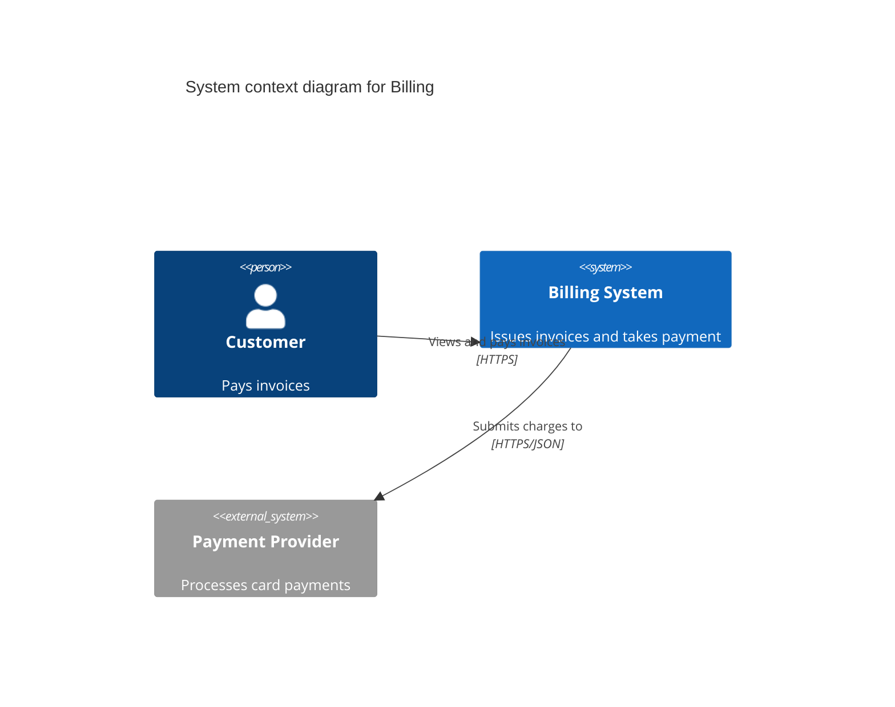
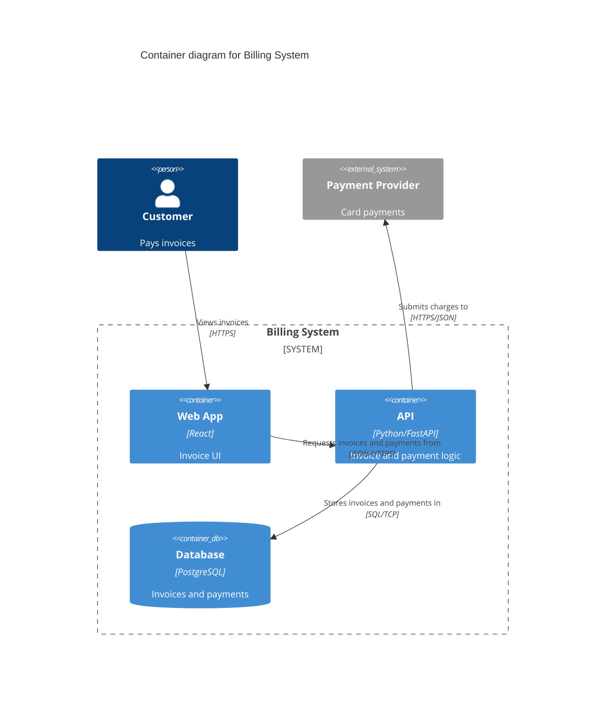
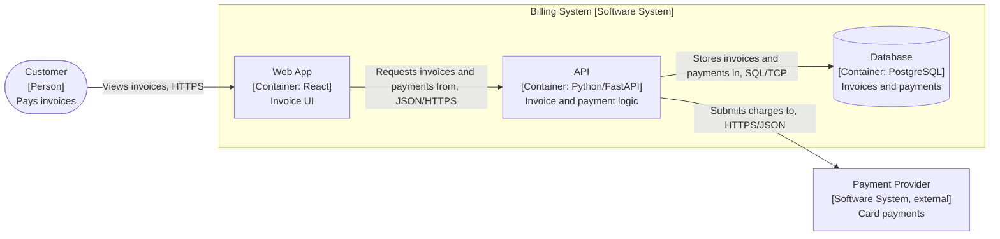

# C4 diagrams

From https://c4model.com/ (verified). Mermaid details from https://mermaid.js.org/syntax/c4.html (verified).

## Abstractions

- **Person:** a user, role or persona.
- **Software system:** the top-level unit; made of containers.
- **Container:** an application or data store (not a Docker container); holds components.
- **Component:** a grouping of functionality inside a container.
- **Code:** what implements a component.

## Which diagrams

- Levels: 1 system context, 2 container, 3 component, 4 code. Supporting: system landscape, dynamic (runtime flow for one use case), deployment (containers on infrastructure).
- **Default: context and container.** c4model.com: they "are sufficient for most software development teams".
- Component only for a complex container. Code rarely, and generated. Dynamic or deployment when the runtime flow or hosting is the question.

## Notation

From https://c4model.com/diagrams/notation:
- The title states type and scope ("Container diagram for Billing System"), and there's a key.
- Every element has a name, a type and a one-line responsibility; containers and components also state their technology.
- Every relationship is one-way, with a specific label (not a bare "Uses"); between containers, also the protocol.
- Colour is free, but must work in black-and-white and for colour-blind readers.

## In mermaid

Mermaid marks C4 as **experimental**: syntax may change, and layout follows statement order. Pin the mermaid version and render-test where the diagram will be read (GitHub, docs site).

Context (syntax verified in mermaid's docs):

Container (`Container`, `ContainerDb`, `System_Boundary` follow C4-PlantUML naming; unverified, render-test it):

### Fallback: flowchart

When C4 rendering isn't available. Type and technology go in the labels (our convention, not official C4):

